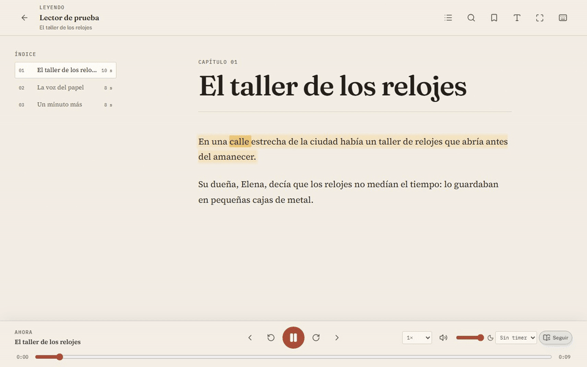

# vibebook

Generador de audiolibros en español latinoamericano a partir de EPUB.

El paquete Python se llama `audiol`; el comando instalado es `vibebook` y
también existe el alias `audiol`. v0 usa Edge TTS por defecto y Azure Speech
como opción para estilos. La salida es un M4B AAC con capítulos y metadata.

## Instalación

Requisitos:

- `uv`, que gestiona Python 3.12 y las dependencias.
- `ffmpeg` y `ffprobe`. Si no están en el sistema, `static-ffmpeg` los
  descarga la primera vez.
- Azure es opcional: `AZURE_SPEECH_KEY` y `AZURE_SPEECH_REGION`.

```bash
curl -LsSf https://astral.sh/uv/install.sh | sh
uv sync
```

No hay que activar ningún venv. `uv run` usa el entorno del proyecto.

## Uso

Listar voces:

```bash
uv run vibebook voices
uv run vibebook voices --locale es-MX
uv run vibebook voices --locale es-PY
```

Convertir un EPUB:

```bash
uv run vibebook convert libro.epub --out out/libro
```

La velocidad por defecto es `-10%`:

```bash
uv run vibebook convert libro.epub --rate -8% --out out/libro-lento
```

Elegir voz:

```bash
uv run vibebook convert libro.epub \
  --voice es-PY-MarioNeural \
  --out out/libro-py
```

Simular sin escribir archivos:

```bash
uv run vibebook convert libro.epub --dry-run
```

Azure con estilo:

```bash
uv run vibebook convert libro.epub \
  --engine azure \
  --voice es-MX-JorgeNeural \
  --style cheerful \
  --out out/libro-azure
```

Para capturar word boundaries exactos con Azure, instalá el extra opcional:

```bash
uv sync --extra azure-sdk
```

Sin el SDK, Azure usa REST y el lector cae a resaltado por segmento. Con el SDK,
el sidecar/CLI usa `speech_synthesis_word_boundary` y conserva REST como fallback.

### Opciones de `vibebook convert`

| Opción | Default | Descripción |
|---|---|---|
| `--voice` | `es-MX-JorgeNeural` | Voz del catálogo |
| `--engine` | `edge` | `edge`, `azure` o `fake` para tests |
| `--style` | `neutral` | Estilo Azure; requiere `--engine azure` |
| `--rate` | `-10%` | Velocidad entre `-100%` y `+100%` |
| `--out` | `out/<nombre-del-epub>` | Carpeta de salida |
| `--max-chars` | `400` | Tamaño máximo de cada segmento |
| `--dry-run` | No | No escribe archivos; imprime estadísticas |
| `--force` | No | Re-sintetiza aunque exista el caché |
| `--no-timings` | No | No escribe `timings/` ni sidecars de palabras |

### Salidas

- `book.md`: texto limpio y segmentado.
- `manifest.json`: metadata, voz, motor, estilo, velocidad, segmentos y estado.
- `timings/chapter_XXX.json`: tiempos por segmento y palabra para el lector.
- `audio/segments/`: audio por segmento con caché reanudable.
- `audio/chapters/`: MP3 por capítulo.
- `<titulo>.m4b`: AAC con capítulos.

Reejecutar sin `--force` reutiliza los segmentos ya sintetizados, incluidos sus
tiempos de palabra. Los capítulos y el M4B se reconstruyen. Usa
`--no-timings` si solo necesitas el M4B y quieres evitar los archivos de
sincronización.

## Interfaz web

La app web incluye biblioteca, importación, estudio de conversión, lector
sincronizado y ajustes.

```powershell
cd web
npm ci
npm run build
cd ..
uv run vibebook studio --library out
```

Abre `http://127.0.0.1:8765`. La API interactiva queda en `/docs` y las opciones
en [docs/studio.md](docs/studio.md).

Para desarrollo, levantá el backend y Vite en dos terminales:

```powershell
# terminal 1
uv run vibebook studio --library out --allow-fake --no-browser

# terminal 2
cd web
npm run dev
```

Vite abre `http://localhost:5173` y hace proxy de `/api` al backend. En
desarrollo aparece el motor `Fake` para probar el flujo sin red.

Comandos de la UI:

```bash
cd web
npm run lint
npm run typecheck
npm run test
npm run build
npx playwright install chromium
npm run e2e
```

### Lector



Cuando un libro está listo, abrí su detalle y elegí **Leer ahora**. El lector
resalta el segmento y la palabra actuales, permite tocar el texto para saltar,
busca dentro del libro, guarda marcadores con nota opcional, alterna con la vista
del EPUB original, recuerda posición y velocidad, y ofrece índice, temas,
tipografía, temporizador y controles del sistema vía Media Session.

Atajos: `Espacio` reproduce o pausa, `←`/`→` retroceden o adelantan, `J`/`K`
cambian de capítulo, `+`/`-` ajustan la velocidad, `T` abre el índice, `F`
pantalla completa y `?` muestra la ayuda.

Hay un EPUB de muestra en
[`samples/lector-de-prueba.epub`](samples/lector-de-prueba.epub) para probar el
flujo completo con el motor `Fake`.

## App de escritorio

La app de escritorio usa Tauri y empaqueta el backend Python y ffmpeg en un
sidecar. No necesita Python ni Node instalados para ejecutarse.

Requisitos: Windows 10/11 x64, WebView2 (incluido en Windows 11) e internet para
Edge TTS.

Para desarrollo:

```powershell
npm ci
npm ci --prefix web
uv sync
make sidecar
npm run desktop:dev
```

Para generar instaladores y una carpeta portable:

```powershell
make sidecar
npm run desktop:build
```

El modo portable se activa creando un archivo `portable.flag` junto a
`Vibebook.exe`; la biblioteca se guarda en `data/library` al lado del ejecutable.
Los logs del sidecar quedan en
`%LOCALAPPDATA%\com.vibebook.desktop\logs\vibebook-sidecar.log`.

Más detalle en [docs/desktop.md](docs/desktop.md).

## Voces

| Voz | Locale | Género | Motores | Estilos |
|---|---|---|---|---|
| `es-MX-JorgeNeural` | `es-MX` | masculino | Edge, Azure | `chat`, `cheerful`, `excited`, `sad`, `whispering` |
| `es-MX-DaliaNeural` | `es-MX` | femenino | Edge, Azure | `cheerful`, `sad`, `whispering` |
| `es-PY-MarioNeural` | `es-PY` | masculino | Edge | - |
| `es-PY-TaniaNeural` | `es-PY` | femenino | Edge | - |

Edge solo admite estilo neutral. Los estilos requieren `--engine azure`.

Edge TTS es un servicio no oficial y puede limitar peticiones. Azure Speech
incluye 0,5 M de caracteres al mes en la capa gratuita.

## Pipeline

1. Leer el EPUB.
2. Limpiar y segmentar el texto.
3. Sintetizar con Edge o Azure, con caché por voz, motor, estilo y velocidad.
4. Capturar tiempos por palabra y construir el timing de cada capítulo.
5. Concatenar por capítulo y normalizar el volumen.
6. Ensamblar el M4B con ffmpeg.

## Tests y calidad

```bash
uv run pytest
uv run ruff check .
uv run ruff format --check .
uv run mypy src
make check
```

Los tests usan `FakeProvider` para no tocar la red. Los tests de ffmpeg usan
`find_binary()` y se saltan si no hay binario disponible.

## Desarrollo

Herramientas de muestra y bake-off:

```bash
./scripts/fetch_sample.sh
uv run python scripts/prepare_sample.py
uv run python scripts/bakeoff_latam.py
```

Documentación:

- [Arquitectura](docs/architecture.md)
- [Desarrollo](docs/development.md)
- [Release](docs/release.md)
- [Rendimiento](docs/performance.md)
- [Changelog](CHANGELOG.md)
- [Roadmap](docs/roadmap.md)
- [Bake-off histórico](docs/archive/bakeoff-2026-10.md)
- [Scorecard de escucha](results/listening-scorecard.md)

## Licencia

Vibebook se distribuye bajo **GNU Affero General Public License v3.0 only**
(`AGPL-3.0-only`). Ver [LICENSE](LICENSE).

Las dependencias de terceros conservan sus propias licencias. Revisá
[packaging/THIRD_PARTY_NOTICES.md](packaging/THIRD_PARTY_NOTICES.md) antes de
redistribuir binarios, especialmente por FFmpeg y los componentes copyleft.

## Contribuir y seguridad

- [Guía de contribución](CONTRIBUTING.md)
- [Política de seguridad](SECURITY.md)
- [Checklist de release](docs/release.md)
