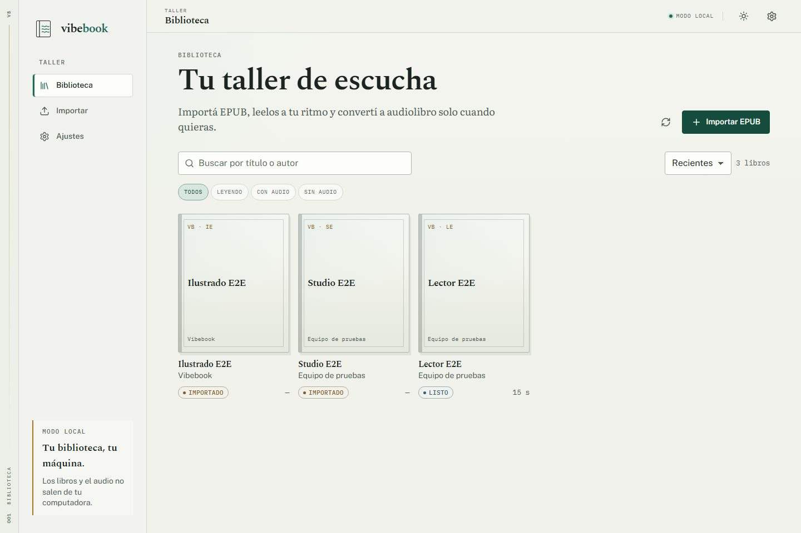
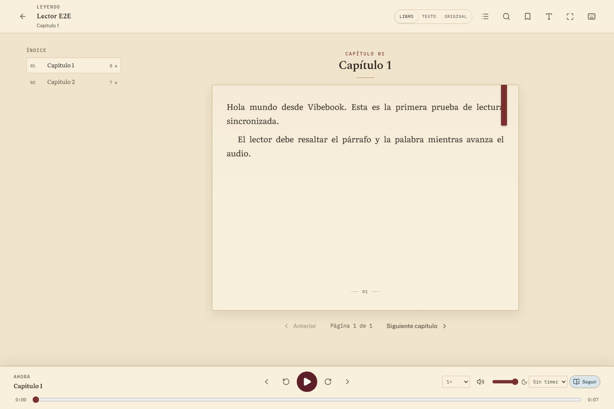

# vibebook

Generador de audiolibros en español latinoamericano a partir de EPUB.

El paquete Python se llama `audiol`; el comando instalado es `vibebook` y
también existe el alias `audiol`. La conversión es local-first: Piper si está
instalado, eSpeak NG como fallback, y Edge/Azure solo como legado explícito. La
salida es un M4B AAC con capítulos y metadata.

El Studio usa un token local y tickets firmados de corta duración para los
medios; el escritorio lo pasa por `stdin`, nunca por la línea de comandos. Ver
[`SECURITY.md`](SECURITY.md) y [`docs/security-audit.md`](docs/security-audit.md).

## Instalación

Requisitos:

- `uv`, que gestiona Python 3.12 y las dependencias.
- `ffmpeg` y `ffprobe`. Si no están en el sistema, `static-ffmpeg` los
  descarga la primera vez.
- Azure es opcional: `AZURE_SPEECH_KEY` y `AZURE_SPEECH_REGION`.
- Piper es opcional: binario local y voz `es_MX-ald-medium`.
- eSpeak NG es opcional: binario local y voz `es-419`; ver
  [docs/engines.md](docs/engines.md).

```bash
curl -LsSf https://astral.sh/uv/install.sh | sh
uv sync
```

No hay que activar ningún venv. `uv run` usa el entorno del proyecto.

## Uso

Listar motores y voces:

```bash
uv run vibebook engines
uv run vibebook voices
uv run vibebook voices --locale es-MX
uv run vibebook voices --engine piper
```

Preparar Piper local (opcional):

```bash
uv run vibebook piper download
uv run vibebook piper status
```

Plugins VEP: agregá un servidor HTTP/JSON desde Ajustes o por API; la plantilla
mínima está en
[`examples/plugin-template`](examples/plugin-template/README.md) y el contrato
en [docs/engines.md](docs/engines.md).

Reparar la sincronización de un libro viejo que ya tiene segmentos:

```bash
uv run vibebook repair-sync out/libro
```

Reparar la segmentación de un libro convertido antes del fix de palabras
cortadas (primero se puede revisar sin tocar nada):

```bash
uv run vibebook repair-segments out/libro --dry-run
uv run vibebook repair-segments out/libro
uv run vibebook repair-restore out/libro --list
uv run vibebook repair-restore out/libro
```

La reparación reutiliza el audio cuyo texto no cambió, reensambla solo los
capítulos afectados y guarda una copia en `backups/` antes de escribir.

Ambientación open source: biblioteca de sonidos CC0/importados, camas
procedurales con ffmpeg, plan por capítulo, análisis heurístico y export M4B
ambientado. Sin APIs pagas ni IA obligatoria. Freesound y los plugins locales de
sonido son opcionales y explícitos. Detalle y endpoints en
[docs/ambience.md](docs/ambience.md).

Convertir un EPUB (elige Piper o eSpeak NG automáticamente):

```bash
uv run vibebook convert libro.epub --out out/libro
```

Si no hay motor local, indicá el legado explícitamente:

```bash
uv run vibebook convert libro.epub --engine edge --out out/libro-edge
```

La velocidad por defecto es `-10%`:

```bash
uv run vibebook convert libro.epub --rate -8% --out out/libro-lento
```

Elegir voz:

```bash
uv run vibebook convert libro.epub \
  --voice es-PY-MarioNeural \
  --out out/libro-py
```

Convertir con Piper, sin red:

```bash
uv run vibebook convert libro.epub \
  --engine piper \
  --voice es_MX-ald-medium \
  --out out/libro-piper
```

Simular sin escribir archivos:

```bash
uv run vibebook convert libro.epub --dry-run
```

Azure con estilo:

```bash
uv run vibebook convert libro.epub \
  --engine azure \
  --voice es-MX-JorgeNeural \
  --style cheerful \
  --out out/libro-azure
```

Para capturar word boundaries exactos con Azure, instalá el extra opcional:

```bash
uv sync --extra azure-sdk
```

Sin el SDK, Azure usa REST y el lector cae a resaltado por segmento. Con el SDK,
el sidecar/CLI usa `speech_synthesis_word_boundary` y conserva REST como fallback.

### Opciones de `vibebook convert`

| Opción | Default | Descripción |
|---|---|---|
| `--voice` | según el motor | Voz del catálogo |
| `--engine` | local-first | `piper`, `espeak`, `edge`, `azure` o `fake` para tests |
| `--style` | `neutral` | Estilo Azure; requiere `--engine azure` |
| `--rate` | `-10%` | Velocidad entre `-100%` y `+100%` |
| `--out` | `out/<nombre-del-epub>` | Carpeta de salida |
| `--max-chars` | `400` | Tamaño máximo de cada segmento |
| `--dry-run` | No | No escribe archivos; imprime estadísticas |
| `--force` | No | Re-sintetiza aunque exista el caché |
| `--no-timings` | No | No escribe `timings/` ni sidecars de palabras |

### Salidas

- `book.md`: texto limpio y segmentado.
- `manifest.json`: metadata, voz, motor, estilo, velocidad, segmentos y estado.
- `timings/chapter_XXX.json`: tiempos por segmento y palabra para el lector.
- `audio/segments/`: audio por segmento con caché reanudable.
- `audio/chapters/`: MP3 por capítulo.
- `<titulo>.m4b`: AAC con capítulos.

Reejecutar sin `--force` reutiliza los segmentos ya sintetizados, incluidos sus
tiempos de palabra. Los capítulos y el M4B se reconstruyen. Usa
`--no-timings` si solo necesitas el M4B y quieres evitar los archivos de
sincronización.

## Interfaz web

La app web incluye biblioteca, importación, estudio de conversión, lector
sincronizado y ajustes. La biblioteca usa un estante de portadas 4:5 con lomo y
progreso; el detalle agrega colofón y ficha, y el lector respeta la paleta
elegida por libro.

```powershell
cd web
npm ci
npm run build
cd ..
uv run vibebook studio --library out
```

Abre `http://127.0.0.1:8765`. La API interactiva queda en `/docs` y las opciones
en [docs/studio.md](docs/studio.md).

Para desarrollo, levantá el backend y Vite en dos terminales:

```powershell
# terminal 1
uv run vibebook studio --library out --allow-fake --no-browser

# terminal 2
cd web
npm run dev
```

Vite abre `http://localhost:5173` y hace proxy de `/api` al backend. En
desarrollo aparece el motor `Fake` para probar el flujo sin red.

Comandos de la UI:

```bash
cd web
npm run lint
npm run typecheck
npm run test
npm run build
npx playwright install chromium
npm run e2e
```

### Lector


Cuando un libro está listo, abrí su detalle y elegí **Leer ahora**. El lector
resalta el segmento y la palabra actuales, permite tocar el texto para saltar,
busca dentro del libro, guarda marcadores con nota opcional, alterna con la vista
del EPUB original, recuerda posición y velocidad, y ofrece índice, paleta de
lectura (papel, sepia o noche), tipografía, temporizador y controles del sistema
vía Media Session. El tema de la app y la paleta del lector son independientes:
podés leer en noche con la app en claro, o al revés. En Modo Libro, al terminar
un capítulo seguís con el siguiente sin volver al índice; también podés pasar
página con swipe en mobile.

Si el libro tiene un plan de ambientación, el lector muestra un toggle de
ambiente con volumen y escena. También funciona en libros sin audio (A4b), con
una cama suave de fondo. Desde el detalle podés generar camas, analizar el plan
y exportar un M4B ambientado sin tocar el original.

Atajos: `Espacio` reproduce o pausa, `←`/`→` retroceden o adelantan, `J`/`K`
cambian de capítulo, `+`/`-` ajustan la velocidad, `T` abre el índice, `F`
pantalla completa y `?` muestra la ayuda.

Hay un EPUB de muestra en
[`samples/lector-de-prueba.epub`](samples/lector-de-prueba.epub) para probar el
flujo completo con el motor `Fake`.

### Identidad

La dirección visual es **Biblioteca**: pergamino cálido, tinta, oxblood, latón
y pizarra. La app y el lector tienen luces independientes.

| Biblioteca | Lector sepia |
|---|---|
|  |  |

Capturas, contraste, axe y límites en [docs/identity-qa.md](docs/identity-qa.md).

## App de escritorio

La app de escritorio usa Tauri y empaqueta el backend Python y ffmpeg en un
sidecar. No necesita Python ni Node instalados para ejecutarse.

Plataformas: Windows 10/11 x64 (WebView2), Linux x64 (WebKitGTK 4.1/GTK3),
macOS arm64/x64 unsigned y Android lector-only (MVP, sin sidecar). Piper es
opcional y funciona sin internet.

Para desarrollo:

```powershell
npm ci
npm ci --prefix web
uv sync
npm run sidecar
npm run desktop:dev
```

Para generar instaladores y una carpeta portable:

```powershell
npm run sidecar
npm run desktop:build
```

En Linux usar `--bundles appimage,deb`; en macOS `--bundles dmg` y el target
correspondiente. El modo portable se activa creando `portable.flag` junto al
ejecutable; la biblioteca se guarda en `data/library` al lado del ejecutable.
Los logs del sidecar quedan en el directorio de logs de la app
(`%LOCALAPPDATA%\com.vibebook.desktop\logs` en Windows).

Más detalle en [docs/desktop.md](docs/desktop.md) y
[docs/engines.md](docs/engines.md).

## Voces

| Voz | Locale | Género | Motores | Estilos |
|---|---|---|---|---|
| `es-MX-JorgeNeural` | `es-MX` | masculino | Edge, Azure | `chat`, `cheerful`, `excited`, `sad`, `whispering` |
| `es-MX-DaliaNeural` | `es-MX` | femenino | Edge, Azure | `cheerful`, `sad`, `whispering` |
| `es-PY-MarioNeural` | `es-PY` | masculino | Edge | - |
| `es-PY-TaniaNeural` | `es-PY` | femenino | Edge | - |
| `es_MX-ald-medium` | `es-MX` | masculino | Piper | - |
| `es-419` | `es-419` | neutral | eSpeak NG | - |

Edge solo admite estilo neutral. Los estilos requieren `--engine azure`. Piper y
eSpeak NG no usan estilos y devuelven timing por segmento.

Edge TTS es un servicio no oficial y puede limitar peticiones. Azure Speech
incluye 0,5 M de caracteres al mes en la capa gratuita.

## Pipeline

1. Leer el EPUB.
2. Limpiar y segmentar el texto.
3. Sintetizar con Edge o Azure, con caché por voz, motor, estilo y velocidad.
4. Capturar tiempos por palabra y construir el timing de cada capítulo.
5. Concatenar por capítulo y normalizar el volumen.
6. Ensamblar el M4B con ffmpeg.

## Tests y calidad

```bash
uv run pytest
uv run ruff check .
uv run ruff format --check .
uv run mypy src
make check
```

Los tests usan `FakeProvider` para no tocar la red. Los tests de ffmpeg usan
`find_binary()` y se saltan si no hay binario disponible.

## Desarrollo

Herramientas de muestra y bake-off:

```bash
./scripts/fetch_sample.sh
uv run python scripts/prepare_sample.py
uv run python scripts/bakeoff_latam.py
```

Documentación:

- [Arquitectura](docs/architecture.md)
- [Desarrollo](docs/development.md)
- [Release](docs/release.md)
- [Rendimiento](docs/performance.md)
- [Linux y Flatpak](docs/linux.md)
- [Android](docs/android.md)
- [Seguridad](SECURITY.md)
- [Auditoría de seguridad](docs/security-audit.md)
- [Changelog](CHANGELOG.md)
- [Roadmap](docs/roadmap.md)
- [Bake-off histórico](docs/archive/bakeoff-2026-10.md)
- [Scorecard de escucha](results/listening-scorecard.md)

## Licencia

Vibebook se distribuye bajo **GNU Affero General Public License v3.0 only**
(`AGPL-3.0-only`). Ver [LICENSE](LICENSE).

Las dependencias de terceros conservan sus propias licencias. Revisá
[packaging/THIRD_PARTY_NOTICES.md](packaging/THIRD_PARTY_NOTICES.md) antes de
redistribuir binarios, especialmente por FFmpeg y los componentes copyleft.

## Contribuir y seguridad

- [Guía de contribución](CONTRIBUTING.md)
- [Política de seguridad](SECURITY.md)
- [Checklist de release](docs/release.md)
