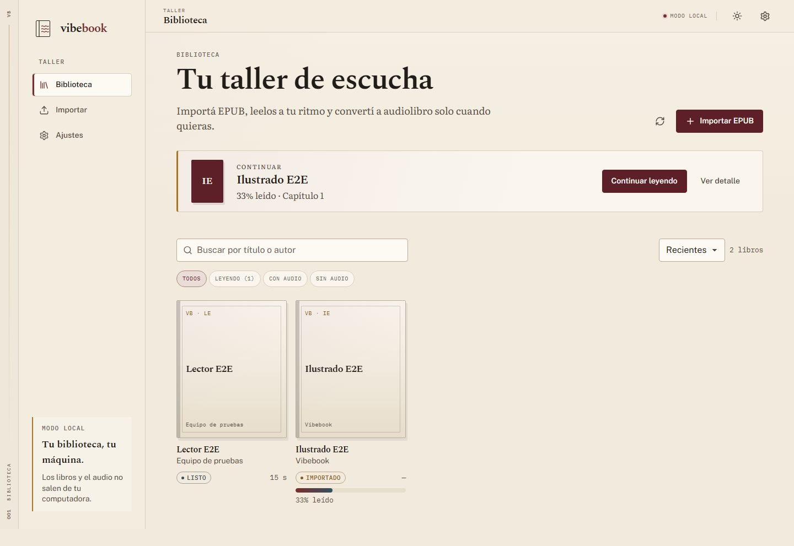
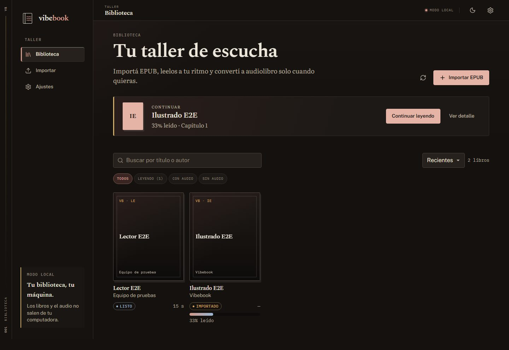
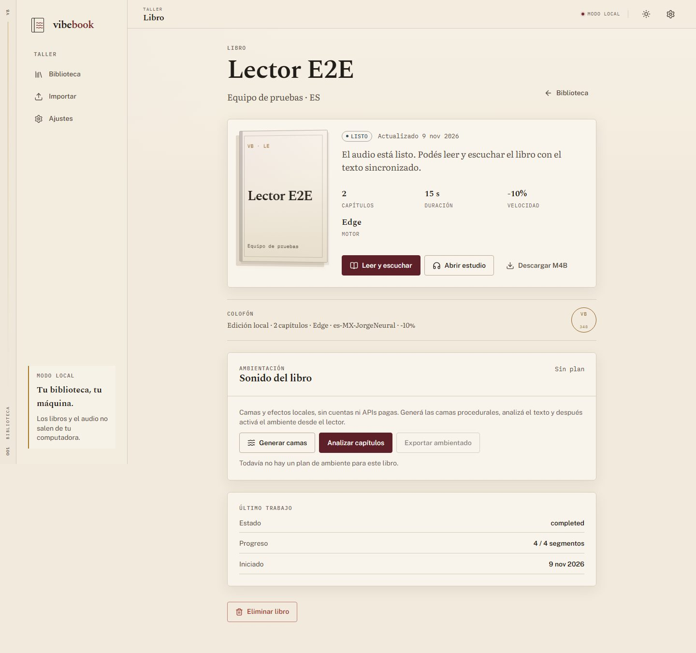
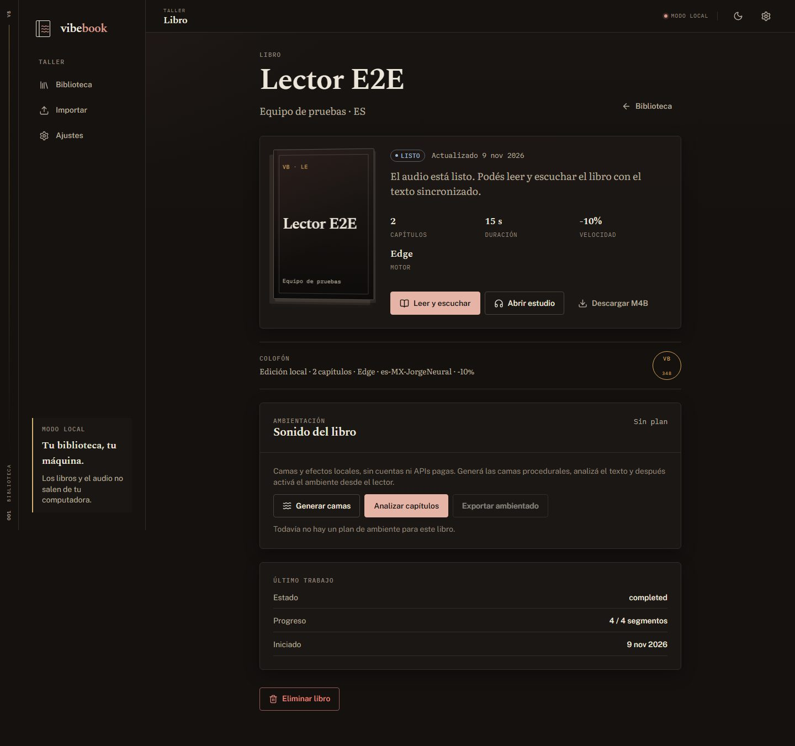
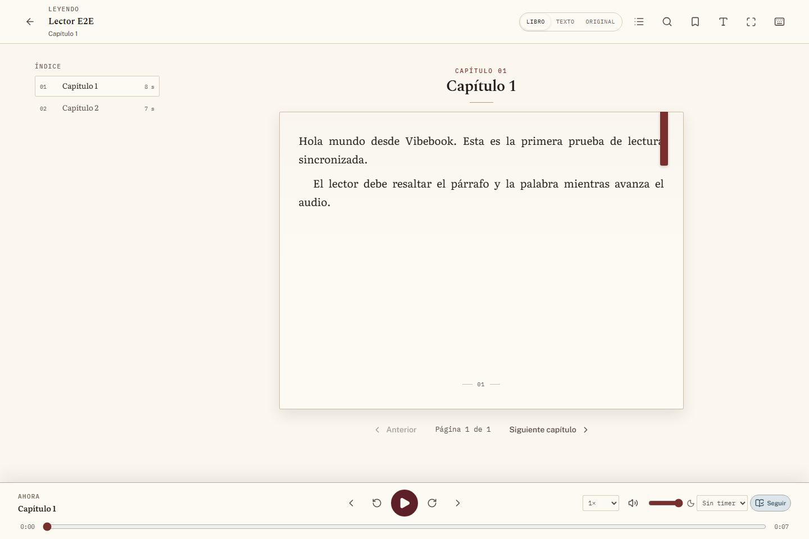
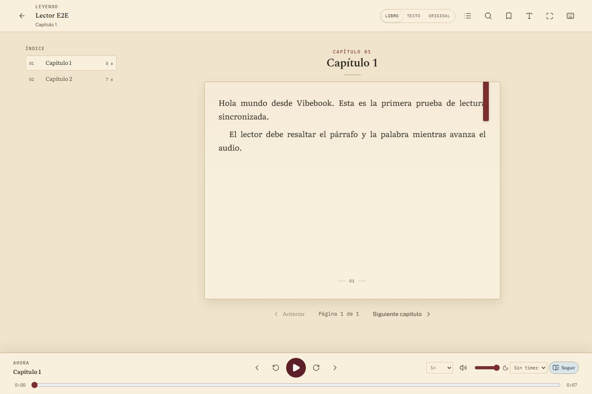
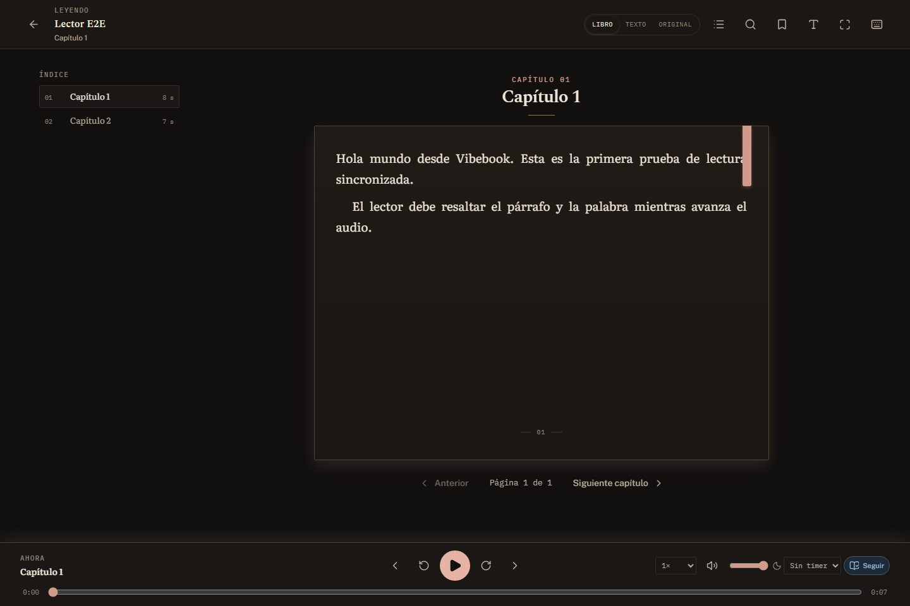
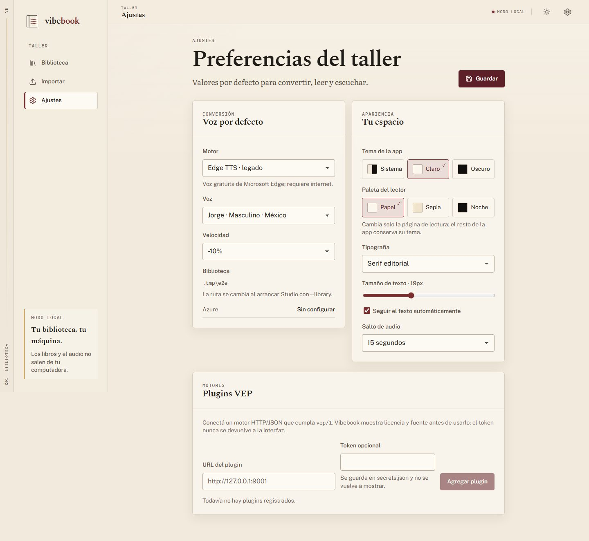
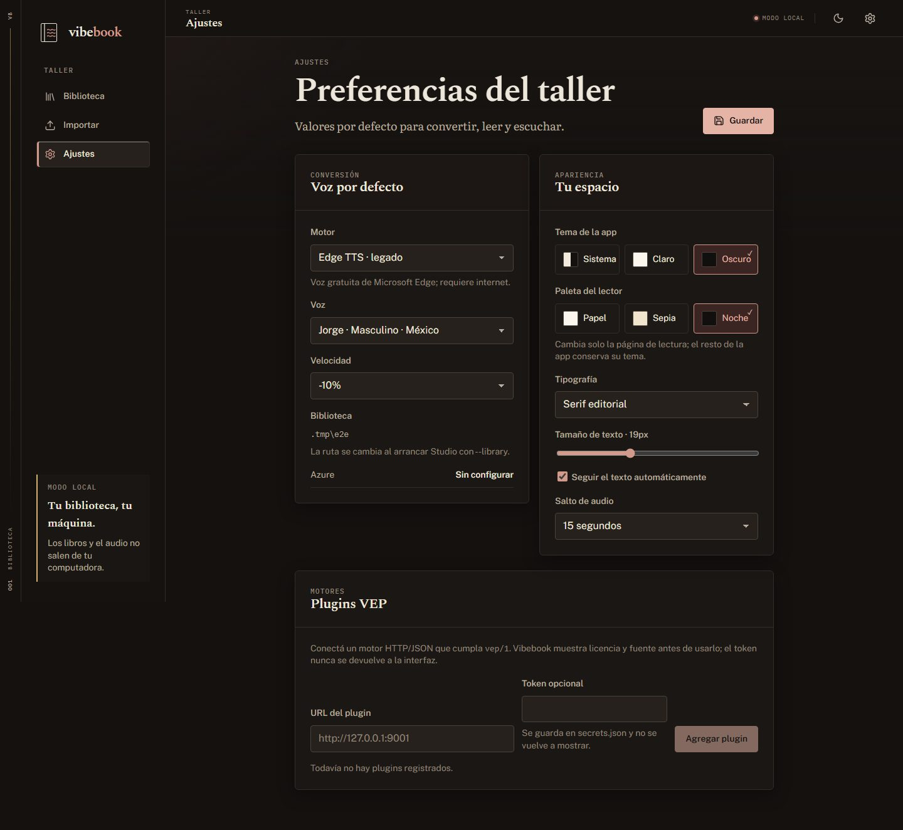

# Identidad Biblioteca — QA visual

> Cierre visual de la ola I1–I5 y de la paleta Biblioteca. Las capturas usan los
> fixtures de E2E y un libro convertido con el motor `fake`; no son assets de
> producción. La paleta verde anterior fue reemplazada por pergamino, tinta,
> oxblood, latón y pizarra.

## Capturas

Todas a 1440 × 960, con las fuentes de producción y los tokens reales.

### Biblioteca

| Claro | Oscuro |
|---|---|
|  |  |

### Detalle

| Claro | Oscuro |
|---|---|
|  |  |

### Lector

| Papel (app clara) | Sepia (app clara) | Noche (app oscura) |
|---|---|---|
|  |  |  |

El lector noche con app oscura demuestra que la paleta de lectura no depende del
tema de la app. La app clara con lector sepia demuestra lo mismo en la otra
dirección.

### Ajustes / Apariencia

| Claro | Oscuro |
|---|---|
|  |  |

## Axe y teclado

- `cd web && npm run e2e` → **9 tests**, incluido `a11y.spec.ts` con AxeBuilder
  en biblioteca, detalle, estudio y lector.
- Resultado: **sin violaciones serious/critical**.
- La navegación mobile se cubre en `shell.spec.ts`.
- El toggle de tema se cubre en `shell.spec.ts` y `theme.spec.ts`.
- `responsive.spec.ts` verifica 720p, 768p, 1080p, tablet y mobile sin overflow
  horizontal ni solapamiento entre página, navegación y player.
- Skip link, foco visible, `aria-current`, `aria-pressed` y labels de tema se
  mantienen.

## Contraste manual

Pares principales (WCAG AA normal = 4.5:1):

| Par | Ratio | Resultado |
|---|---:|---|
| Claro · ink / paper | 14.11 | AA |
| Claro · ink-soft / paper | 7.02 | AA |
| Claro · ink-faint / paper | 4.99 | AA |
| Claro · on-accent / accent-strong | 11.77 | AA |
| Claro · warning / paper | 4.92 | AA |
| Claro · danger / paper | 5.52 | AA |
| Oscuro · ink / paper | 15.16 | AA |
| Oscuro · ink-faint / paper | 5.25 | AA |
| Oscuro · on-accent / accent-strong | 10.22 | AA |
| Papel · ink / page | 15.67 | AA |
| Sepia · ink / page | 11.62 | AA |
| Sepia · faint / page | 4.91 | AA |
| Noche · ink / page | 15.29 | AA |
| Noche · faint / page | 5.30 | AA |

Se usa `--warning` (`#8C5A1F`) para texto pequeño de latón sobre papel; `--brass`
queda para líneas, cintas y adornos. `--ink-faint` claro es `#6E6258` y el tenue
de sepia es `#6B604D` para pasar AA.

## Responsive

- Matriz: **1920×1080, 1366×768, 1280×720, 1024×768, 768×1024 y 390×844**.
- El alto de página se calcula con `100dvh` menos el chrome del lector; a 720p y
  768p la página, la navegación y el player quedan visibles sin solaparse.
- En mobile la topbar pasa a dos filas (acciones + toggle) y se ocultan
  pantalla completa/atajos; el título del libro se conserva en el encabezado del
  capítulo.
- `responsive.spec.ts` comprueba la geometría en cada viewport.

## Rendimiento

- JS inicial: **154,5 KiB gzip / 550**.
- CSS inicial: **11,5 KiB gzip / 60**.
- Sin Three.js, WebGL, canvas decorativo ni textura de ruido full-screen.
- Se eliminó el último `backdrop-filter: blur()` del player.
- Fuentes: 5 familias OFL, subsets y `font-display: swap`; sin CDN en producción.
- Animaciones: `transform`/`opacity`; reduced motion desactiva el page-turn.

## Limitaciones conocidas

- Las capturas usan un libro de fixture con poco texto; el lector real llena más
  la página.
- Las portadas sin arte usan una tapa tipográfica; títulos largos se clampean a
  4 líneas.
- El modo Álbum se guarda como `reader_mode: book` porque el contrato no tiene un
  valor `album`; al reabrir vuelve a Libro, sin perder la posición.
- Las capturas se generaron en Chromium/Windows; WebKitGTK y WKWebView se revisan
  en las fases de plataforma.
- Los teléfonos en horizontal con menos de 640 px de alto todavía necesitan una
  pasada específica de landscape.

## Regenerar las capturas

Con el backend y Vite corriendo, y un libro convertido:

```powershell
cd web
$env:BOOK_ID="<id-del-libro>"
npm run capture:identity
```

El script deja los JPG en `docs/assets/identity/` y restaura
`theme_mode=system`, `reader_palette=paper` al terminar.
